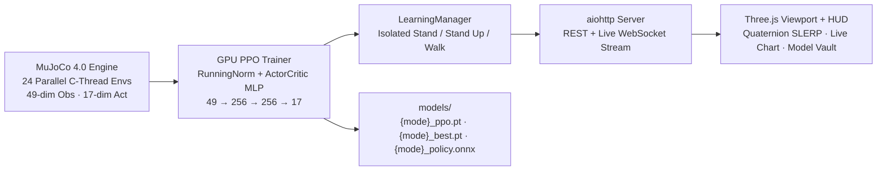

# Steel Sentinel — Real-Time MuJoCo GPU RL Humanoid Lab

[](https://www.python.org/)
[](https://pytorch.org/)
[](https://mujoco.org/)
[](https://threejs.org/)
[](https://docs.aiohttp.org/)

An interactive **17-DoF rigid-body humanoid reinforcement learning lab** combining multi-threaded **MuJoCo 4.0** physics, **GPU PPO (PyTorch)** training from scratch, live quaternion-interpolated **Three.js** rendering over WebSockets, and a **Manual Sandbox** kinematics playground.

All locomotion and recovery behaviors are learned by the neural policy directly from physics interactions and reward shaping—without hardcoded joint trajectories.

---

## Core Architecture



---

## Isolated Training Modes

Each mode is completely isolated end-to-end across UI controls, `LearningManager` telemetry/histories, actuator settings, reward functions, and saved checkpoints in `models/`:

| Mode | Stage ID | Checkpoint Prefix | Objective & Physics Design |
| :--- | :---: | :--- | :--- |
| **Stand** | `0` | `models/stand_*` | Quiet upright balance + recovery against 4-way directional impulses (`Front`, `Back`, `Left`, `Right`) using ankles, hips, knees, and arms. |
| **Stand Up** | `2` | `models/getup_*` | Whole-body ground recovery cycling **supine, prone, left-side, and right-side** starts, using singularity-free local up-vectors (`o[46:49]`), arm/thigh ground contacts, and stage-scoped upper-body push-up torque. |
| **Walk** | `1` | `models/walk_*` | Natural long-stride human walking (`walk_cadence = 4.9`, `target_speed = 2.95`), phase-consistent kinematic stride targets, single-stance ground clearance, and counter-arm swing. |

---

## Quickstart

### 1. Prerequisites

- Python `3.12+` (CUDA GPU recommended; falls back cleanly to CPU)
- Packages:

```bash
pip install torch mujoco aiohttp numpy
```

### 2. Clone & Launch

```bash
git clone https://github.com/GIRIBALANMA/RL-Robot.git
cd RL-Robot
python3 run.py --host 127.0.0.1 --port 8080
```

Open **[http://127.0.0.1:8080/](http://127.0.0.1:8080/)** in your browser.

---

## Interactive Controls

### Learn Mode
- **Model Mode (Isolated):** Switch cleanly between **Stand**, **Stand Up**, and **Walk** (`Train (PPO)` or `Eval Only` deterministic inference).
- **Training Pace:** Pause/Resume or adjust watch speed (`0.5×` – `4×`).
- **Push Recovery Test:** Apply physical directional impulses (`Front`, `Back`, `Left`, `Right`) directly to the simulated robot.
- **Saved Model Vault:**
  - **Save Now:** Atomically persists `<mode>_ppo.pt`, `<mode>_best.pt` (when beating peak score), `<mode>_policy.onnx`, and `<mode>_meta.json` locally under `LearningManager._lock`.
  - **Load:** Scans local `<mode>*.pt` checkpoints in `models/`, restores the highest-scoring model (weights, `RunningNorm`, `log_std`, `Adam` optimizer state, and `update_count`), and resumes PPO training cleanly without restarting from scratch.
  - **Reset:** Re-initializes active mode weights in memory while keeping `_best.pt` protected on disk.
  - Direct `.pt` and `.onnx` download links per active mode.

### Manual Sandbox
Switch to the **Manual Sandbox** tab to drive kinematic poses directly or inspect joint mechanics (`A`/`D` or `←`/`→` walk, `Shift` run, `W` wave, `↑` jump, `↓` prone, plus 17 per-joint sliders). See [control.md](control.md) for full rigging and axis conventions.

---

## Server API Reference

| Endpoint | Method | Description |
| :--- | :---: | :--- |
| `/` | `GET` | Serves the Steel Sentinel Three.js Lab (`robot.html`) |
| `/ws` | `WS` | Real-time telemetry + quaternion/joint hero frame stream (`control` actions supported) |
| `/api/status` | `GET` | Current telemetry snapshot, active mode info, and initial hero frame |
| `/api/control` | `POST` | Update `mode` (`stand` \| `getup` \| `walk`), `play_mode` (`train` \| `eval`), `paused`, or `speed_mult` |
| `/api/nudge` | `POST` | Inject physical impulse (`{"dir": "front" \| "back" \| "left" \| "right" \| "random"}`) |
| `/api/models/save` | `POST` | Atomic local save (`{"mode": ...}`) to `.pt`, `.onnx`, and `_meta.json` |
| `/api/models/load` | `POST` | Load highest-scoring local `.pt` checkpoint for the requested mode |
| `/api/models/reset` | `POST` | Reset in-memory weights and stats for the requested mode from scratch |
| `/api/models/download/{filename}` | `GET` | Download saved `<mode>_{ppo.pt,best.pt,policy.onnx,meta.json}` artifacts |

---

## Repository Structure

```text
RL-Robot/
├── run.py                      # CLI entrypoint (--host, --port)
├── robot.html                  # Main SPA UI (Learn Mode + Manual Sandbox)
├── control.md                  # Humanoid rigging, coordinate frames, and motion spec
├── styles/main.css             # HUD & responsive viewport styles
├── models/                     # Isolated local checkpoints (.pt, .onnx, _meta.json)
├── server/
│   ├── app.py                  # aiohttp web routes, static serving & WebSocket hub
│   ├── physics.py              # Multi-threaded MuJoCo BipedPhysicsEnv (Stages 0/1/2)
│   ├── ppo.py                  # GPU Actor-Critic PPO, RunningNorm, atomic save/load & ONNX export
│   ├── trainer.py              # Async LearningManager orchestrating rollout/update loop & locks
│   ├── reflex.py               # 17-joint constants, ACT_SCALE & MuJoCo↔Three.js quaternion math
│   └── sentinel.xml            # Rigid-body MuJoCo humanoid MJCF model & actuators
└── src/
    ├── main.js                 # Frontend bootstrap tying Three.js scene, controls & HUD
    ├── animation/
    │   ├── liveClient.js       # WebSocket/REST client + shortest-path quaternion SLERP
    │   └── loop.js             # Learn Mode live renderer + Manual Sandbox animator
    ├── robot/model.js          # Three.js humanoid rig & pose application
    ├── scene/                  # WebGL renderer, camera, lighting & scenery
    ├── input/controls.js       # Keyboard, touch & orbit controls
    └── ui/                     # Learning HUD controller & joint slider panel
```

---

## Collaborator Guide

- **Keep observation/action contract stable:** `OBS_DIM = 49` and `ACT_DIM = 17` across all modes (`o[46:49]` carries mode-specific context so checkpoints remain compatible).
- **Preserve mode isolation:** Reward changes in [server/physics.py](server/physics.py) should stay scoped to `self.stage == 0` (`stand`), `1` (`walk`), or `2` (`getup`) without mutating baseline XML gains/contacts used by already-trained policies.
- **Coordinate frames:** MuJoCo uses `+X` forward, `+Y` left, `+Z` up; Three.js uses `+X` forward, `+Y` up, `-Z` left. `server/reflex.py` (`mj_quat_to_three_quat_xyzw`) maps orientations cleanly with quaternion SLERP to avoid Euler gimbal lock during ground recovery.
